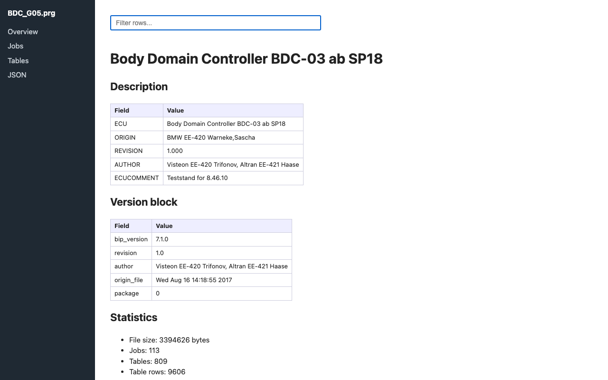
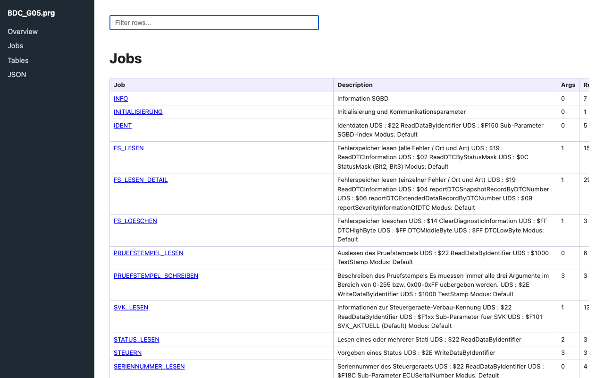
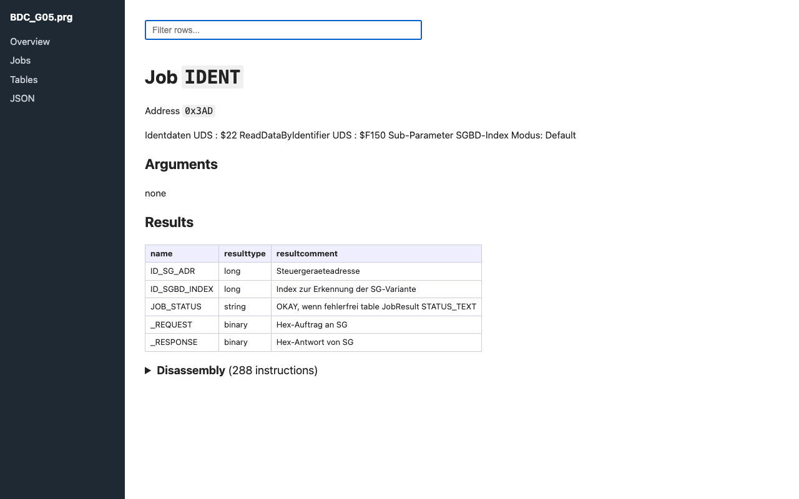
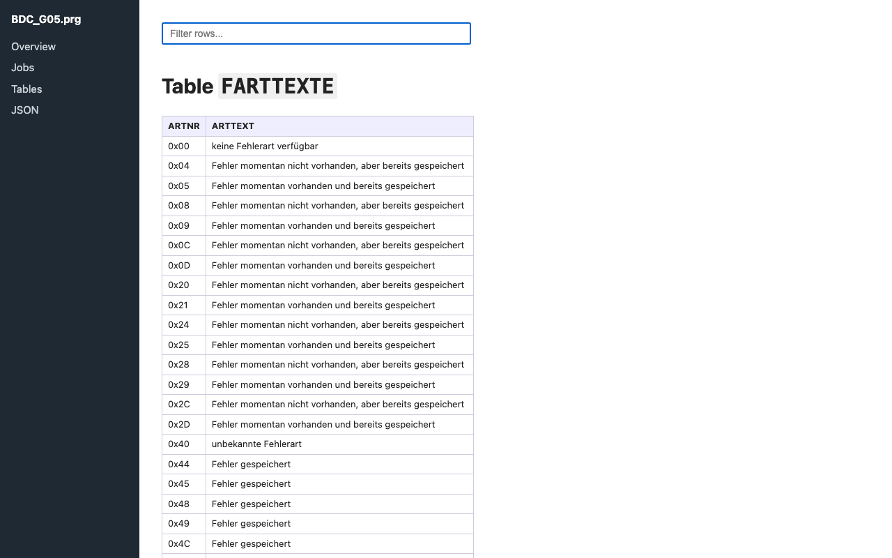

# bmw-prg-decoder

Decode EDIABAS BEST/2 `.prg` files (BMW ECU description files) into readable
documentation: jobs, tables, and disassembled code. Pure Python 3, no dependencies.

## Usage

Put your `.prg` files in the `ECU/` folder (it is git-ignored, so they are never committed).

### Dump to JSON

```sh
python3 -I parse_prg.py ECU/BDC_G05.prg > bdc_g05.json
```

Or from Python:

```python
from parse_prg import parse_prg
data = parse_prg("ECU/BDC_G05.prg")
```

### Browse as an HTML book

```sh
python3 -I serve_book.py --file ECU/BDC_G05.prg --port 8000
```

Then open <http://localhost:8000>. Routes:

| Route | Content |
|---|---|
| `/` | Overview |
| `/jobs`, `/job/<name>` | Job list and disassembly |
| `/tables`, `/table/<name>` | Table list and contents |
| `/api/json` | Full parsed JSON |

## Screenshots

| Overview | Jobs |
|---|---|
|  |  |
| **Job detail** | **Table** |
|  |  |

## License

[MIT](LICENSE).

## Disclaimer

Unofficial tool for interoperability and educational purposes. The `.prg` files
are not included and remain the property of their owners.
